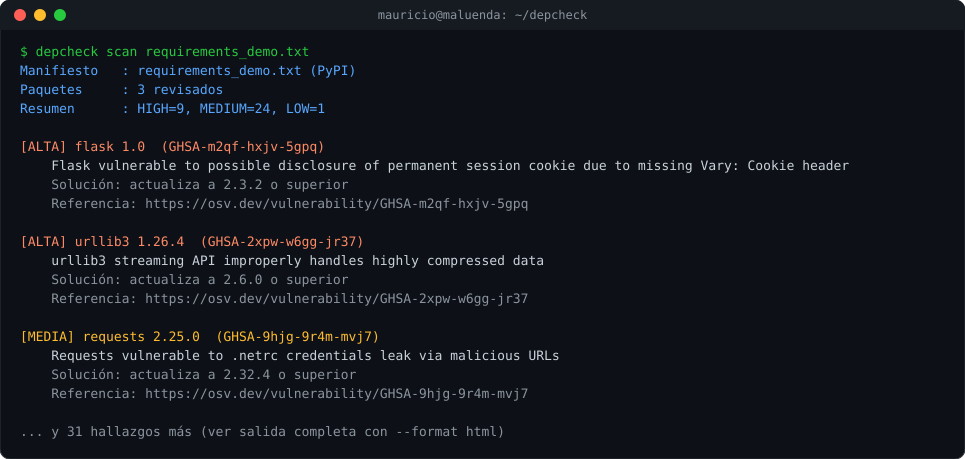

# DepCheck


Revisor de dependencias vulnerables en Python, hermano de
[WebScan](../webscan), [SubdomainEnum](../subdomain-enum),
[PwCheck](../pwcheck) y [GitSecrets](../gitsecrets). Revisa cada paquete
de tu `requirements.txt` o `package.json` contra **OSV.dev** (Open Source
Vulnerabilities), la base de datos pública de vulnerabilidades de código
abierto que mantienen Google y la comunidad — la misma fuente que usan
`pip-audit`, `npm audit` y Dependabot por debajo.

## Cómo funciona

1. Lee el manifiesto y extrae cada paquete con su **versión exacta**
   (sin versión fijada no se puede verificar con certeza: se reporta como
   nota, no se omite en silencio).
2. Consulta OSV.dev **por lotes** (todos los paquetes en una sola
   petición) para saber qué IDs de vulnerabilidad afectan a cada versión
   exacta.
3. Pide el detalle de cada ID único encontrado (descripción, severidad,
   versión que la corrige).

## Demo



## Instalación (Windows / PowerShell)

```powershell
python -m venv .venv
.\.venv\Scripts\Activate.ps1
pip install -r requirements.txt
```

## Uso

```powershell
# Python
python -m depcheck scan requirements.txt

# Node (versiones simples en package.json; para resolución exacta usa package-lock.json)
python -m depcheck scan package.json

# Reporte en HTML o JSON
python -m depcheck scan requirements.txt --format html -o reporte.html

# CI/CD: código de salida 2 si hay algo de severidad alta o superior
python -m depcheck scan requirements.txt --fail-on high
```

## Qué hace con la severidad

Cuando la fuente (GitHub Advisory Database, PyPA...) ya clasifica la
vulnerabilidad como Crítica/Alta/Media/Baja, se usa esa clasificación. Si
no la especifica, se trata como Media y se deja claro que amerita revisión
manual, en vez de inventar una severidad calculando el puntaje CVSS a mano.

## Limitaciones conocidas

- `package.json` guarda *rangos* de versión (`^4.17.15`), no la versión
  exacta instalada — se revisa el límite inferior del rango, que es una
  aproximación razonable pero no siempre es la versión real instalada.
  Para precisión total, lo ideal sería leer `package-lock.json` (pendiente).
- Solo cubre PyPI y npm por ahora.

## Pruebas

```powershell
python -m pytest -q
```

## Ideas para siguientes versiones

- Soporte para `package-lock.json` / `poetry.lock` / `Pipfile.lock`
  (versiones exactamente resueltas, no rangos).
- Integración como GitHub Action para que corra en cada pull request.
